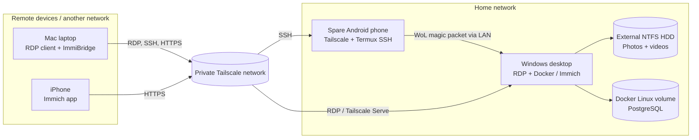

# Remote Access & Self-Hosted Photo Cloud

A home-lab infrastructure project combining **secure remote Windows access**, **Wake-on-LAN (WoL) through an Android SSH relay**, and a **self-hosted Immich photo server** accessed from a Mac and iPhone over Tailscale.

[Architecture](docs/architecture.mmd) · [Operations](docs/OPERATIONS.md) · [Security](docs/SECURITY.md)

## What it does

- **Remote desktop:** Mac → private Tailscale network → Windows Remote Desktop (RDP).
- **Remote power-on:** Mac → SSH using a public/private key pair over Tailscale → spare Android phone with Termux on the Windows LAN → WoL magic packet → powered-off Windows PC.
- **Photo server:** Windows + Docker Desktop/WSL2 → Immich → photos/videos on an external NTFS drive; PostgreSQL data in a Docker-managed Linux volume on the internal SSD.
- **Secure photo access:** Tailscale Serve provides HTTPS within the private tailnet without public router port forwarding.
- **Mac photo ingestion:** ImmiBridge is configured to communicate with Immich. Scheduled incremental backup is **planned but not yet enabled** pending reconnection and verification of the external Apple Photos library.

## Project status

| Component | State | Notes |
|---|---|---|
| Tailscale Mac ↔ Windows | Working | Devices on different networks |
| Remote Desktop | Working | Windows RDP tunneled through Tailscale |
| WoL from Android Termux | Working | Phone relay on same LAN as the Windows desktop; SSH key authentication |
| Immich on Windows | Working | Docker Compose, server, database, cache, ML |
| Immich photo storage on external drive | Verified | Test photo stored on the intended drive |
| Tailscale Serve HTTPS | Working | HTTPS browser access verified from Mac |
| Immich iPhone access | Working | Test image visible in mobile app |
| ImmiBridge API connection | Working | Connection test passed |
| Full Apple Photos backup | Pending | External Mac Photos drive currently unavailable |
| Scheduled incremental backup | Pending | Must verify source selection and dry run first |

## Architecture at a glance



See [Mermaid architecture](docs/architecture.mmd), [remote wake sequence](docs/remote-wake-sequence.mmd), and [photo backup flow](docs/photo-backup-sequence.mmd).

## Repository contents

```text
Remote-Access-Photo-Cloud/
├── README.md                 Project overview
├── .gitignore                Excludes secrets, keys, local config and photos
├── config/
│   ├── mac.env.example       Mac connection placeholders
│   ├── ssh-config.example    SSH alias using a key (no real destination)
│   └── wol.env.example       Phone-only WoL configuration placeholders
├── immich/
│   ├── .env.example          Immich environment settings example
│   └── download-compose.ps1 Download upstream Docker Compose file
├── scripts/
│   ├── mac/                 Wake remote PC, test connections, verify photo source
│   ├── termux/              Python WoL sender and safe shell launcher
│   └── windows/             Start/test Immich, enable Tailscale Serve
├── docs/
│   ├── architecture.mmd
│   ├── remote-wake-sequence.mmd
│   ├── photo-backup-sequence.mmd
│   ├── OPERATIONS.md
│   └── SECURITY.md
├── tests/                    Unit tests; no real network activity
└── tools/check_public_repo.py   Safety scan before publishing
```

## Reproduce the setup

**Prerequisites:** Windows desktop with wired Ethernet and WoL support, a Mac, an Android phone on the Windows LAN, a Tailscale account, Docker Desktop (WSL2 backend) on Windows, a macOS RDP client, and an NTFS photo storage disk. For Mac photo ingestion, install ImmiBridge separately.

### A. Windows remote access

1. Enable Windows Remote Desktop (supported Windows edition required), choose a strong Windows sign-in password, and confirm Windows permits the account to sign in with RDP.
2. Install Tailscale on Mac and Windows, sign into the same private tailnet, and enable **Run unattended** on Windows.
3. Use your Windows device's **Tailscale DNS name/IP** as the RDP destination in your Mac's Windows App / Remote Desktop client.
4. Configure wired Ethernet WoL in the BIOS/UEFI and network adapter properties. Test wake locally before using the relay.
5. **Never** forward RDP or SSH ports on the home router.

### B. Android WoL relay

1. Install Tailscale and Termux on the spare Android phone connected to the Windows LAN. Keep the device powered and handle battery optimization/boot behavior.
2. In Termux: `pkg install openssh python`, set up `sshd`, and place your **public SSH key** in `~/.ssh/authorized_keys`. Use key-only SSH authentication after verifying it works.
3. Copy `scripts/termux/wake_pc.py` and `scripts/termux/wake_pc.sh` to the phone's Termux home and mark the launcher executable.
4. Create `~/.config/remote-photo-cloud/wol.env` **on the phone only** from `config/wol.env.example`. Enter the actual Ethernet MAC of the target PC **only on the phone**, never in Git.
5. Add `config/ssh-config.example` as a **locally edited** block to the Mac's `~/.ssh/config` (replace placeholders privately). Use the `android-wol` alias.
6. On the Mac, run `bash scripts/mac/wake-windows.sh`. It invokes the phone over SSH; the phone broadcasts the WoL packet on the home LAN.

For the complete copy, permission, and recovery commands, see [Operations](docs/OPERATIONS.md).

### C. Immich on the Windows desktop

1. Install Docker Desktop using the **WSL2** backend.
2. Download Immich's **official** `docker-compose.yml` and `example.env` (see `immich/download-compose.ps1`). Use the official upstream Compose file.
3. In the local `.env`, put media on your attached NTFS disk, and set `DB_DATA_LOCATION=pgdata`. Declare `pgdata:` under top-level Compose `volumes` to use a Docker-managed Linux volume; don't place PostgreSQL directly on NTFS.
4. Run `docker compose config -q`, then `docker compose up -d` and `docker compose ps`. Create the admin account through the local Immich UI.
5. Upload one disposable sample image and verify that it appears on the external storage disk.
6. With Tailscale connected, run `tailscale serve --bg 2283` on Windows; access the HTTPS URL shown by Tailscale from the Mac/iPhone. **Use Serve, not Funnel.**

Configure a private `.env` with a unique database password. Preserve your existing working configuration when updating Immich.

### D. Apple Photos → Immich (planned automatic sync)

1. Attach the external drive containing the intended `.photoslibrary` package to the Mac.
2. In Apple Photos, verify **Photos → Settings → General → Library Location** and open a full-resolution original. A green connection badge alone does not prove the correct library is selected.
3. In ImmiBridge: select **Photos**, **Originals** (or **Both** if rendered edits are required), **All**, **Smart** backup mode, and **Immich** destination with the Tailscale Serve HTTPS URL.
4. Create a **least-privilege** Immich API key locally. Do not place it in this repo. Run **Test Connection**, then **Dry Run**, then a small test backup.
5. Only after verification, enable scheduled incremental backup. Avoid **Mirror** unless deletion from the destination is explicitly intended.
6. The Mac must be awake, the source volume mounted, the network available, and Windows/Docker/Immich running for a scheduled job to execute.

**Important:** Immich is a separate photo application; it does not sync its library into the native iOS/macOS Apple Photos application like iCloud Photos.

## Quick commands

```powershell
# Windows PowerShell (inside the existing local Immich install)
cd C:\Immich
docker compose up -d
docker compose ps
tailscale serve status
```

```bash
# Mac Terminal (after local SSH alias and phone script setup)
bash scripts/mac/wake-windows.sh
bash scripts/mac/check-connections.sh
bash scripts/mac/check-photo-source.sh
```

```bash
# Project validation before a public push
python3 -m unittest discover -s tests -v
python3 tools/check_public_repo.py
```

## Security and data durability

- Keys, passwords, full names, email, real machine/domain names, private photo library paths, device identifiers, and IP/MAC addresses must stay **outside Git**.
- Enable MFA for the Tailscale identity provider; apply tailnet access policies; restrict SSH to keys; use strong Windows and Immich passwords.
- WoL packets are unauthenticated **inside the LAN**. Protection is provided by controlling access to the relay via Tailscale and SSH.
- The old Android relay requires regular security assessment; unpatched Android versions increase risk.
- Tailscale Serve keeps Immich private to authorized tailnet devices. Do **not** enable public Funnel for this project.
- A photo server is not a backup by itself. Back up both media files **and** the Immich PostgreSQL database to a separate destination and test restoration.
- Ensure Docker Desktop actually starts after Windows reboots; Tailscale's unattended mode alone does **not** start Docker.

See [Security](docs/SECURITY.md) for the threat model and [Operations](docs/OPERATIONS.md) for common checks.

## References / upstream projects

- [Tailscale Serve documentation](https://tailscale.com/docs/reference/tailscale-cli/serve)
- [Tailscale private server with Docker](https://tailscale.com/docs/solutions/host-private-server-docker)
- [Immich requirements / Windows PostgreSQL volume](https://docs.immich.app/install/requirements/)
- [Immich Docker Compose installation](https://docs.immich.app/install/docker-compose/)
- [Immich backup and restore](https://docs.immich.app/administration/backup-and-restore/)
- [ImmiBridge upstream repository](https://github.com/emerysilb/immibridge)
- [Termux upstream](https://github.com/termux/termux-app)

## License

[MIT](LICENSE)
